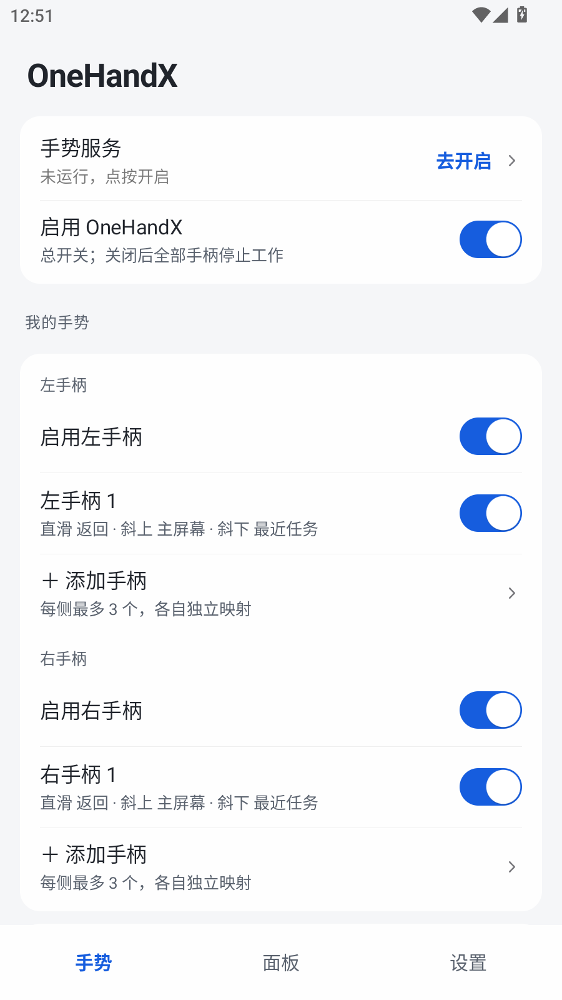
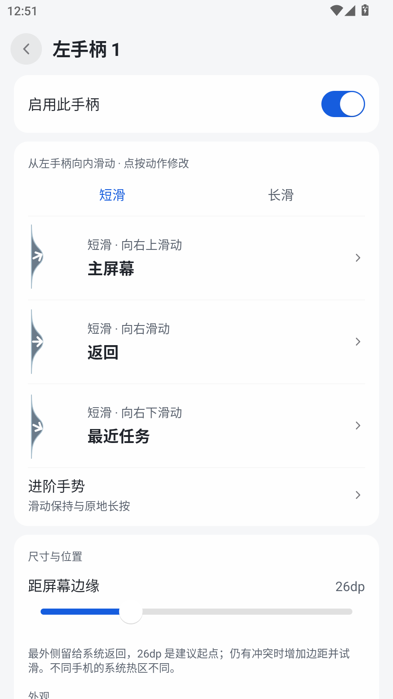
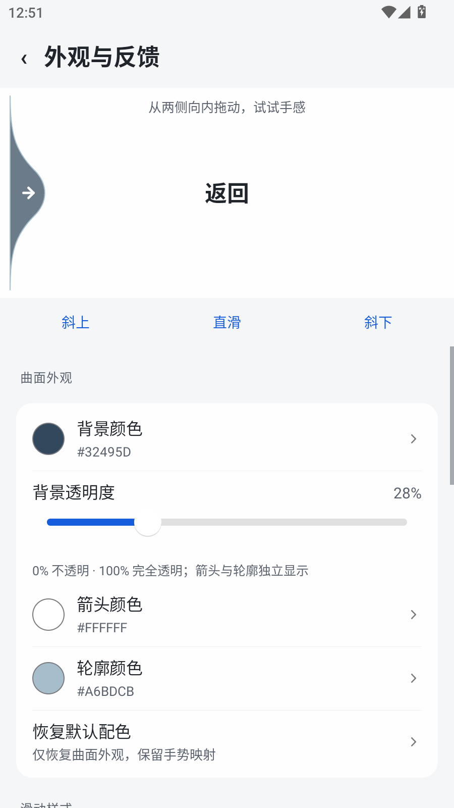
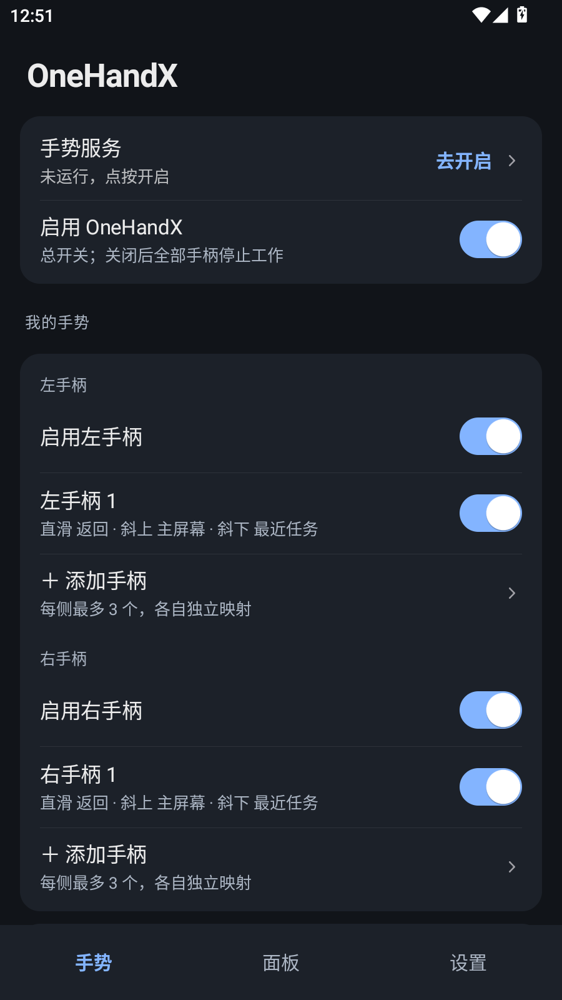

<div align="center">

# OneHandX

**从屏幕两侧向内滑动，完成常用操作。**

<sub>Android 8.0+ · 基础手势无需 Root · 本地运行，无网络权限</sub>

[](https://github.com/Buildlee/oneHandX/releases/tag/v0.6.1)

**v0.6.1 试用版** · 已完成模拟器检查，高刷真机手感仍待复测

[开始使用](#开始使用) · [系统手势共存](#与系统返回共存) · [从源码构建](#从源码构建) · [版本记录](https://github.com/Buildlee/oneHandX/releases)

</div>

<p align="center">
  
  
  
</p>

<p align="center">手势总览 · 方向映射 · 曲面反馈</p>

<details>
<summary>查看深色界面</summary>

<p align="center"></p>

</details>

<sub>以上为 v0.6.0 原生界面的模拟器截图；v0.6.1 在此基础上更新动效。</sub>

## 开始使用

1. [下载 APK](https://github.com/Buildlee/oneHandX/releases/tag/v0.6.1)，安装后打开 OneHandX。
2. 阅读应用内的用途说明，在系统设置中开启「OneHandX 手势服务」。
3. 从左手柄向右滑，或从右手柄向左滑，试用默认的短滑动作。

| 向内滑动的方向 | 默认动作 |
| --- | --- |
| 直滑 | 返回 |
| 斜向上 | 主屏幕 |
| 斜向下 | 最近任务 |

在「手势」中修改动作映射；在「设置 → 外观与反馈」中试滑、换样式与配色。长滑、滑动保持和原地长按也可单独配置。

APK 使用 debug 签名，与 v0.5.1 / v0.6.0 一致，可覆盖安装。建议更新前导出配置；如果更新后无障碍服务被系统停用，请重新开启。

## 与系统返回共存

系统返回也会使用屏幕边缘。OneHandX 默认将手柄**内移 26dp**，最外侧留给系统返回，从手柄位置起滑触发自定义动作。

- 仍有冲突时，到「设置 → 系统手势共存」逐步增大边距，可调范围为 4–80dp。
- 26dp 是建议起点，不同手机的系统热区不同，需按实际手感调整。
- 若希望完全贴边，可自行选择系统三键导航，并按需使用应用内的浮动导航按钮。

应用不会自动接管或切换系统导航。机制与实测记录见[边缘手势冲突研究](docs/边缘手势冲突研究.md)。

## 可以做什么

- **配置双侧手势**：每侧最多 3 个手柄，每个手柄 10 个动作槽位。长度、位置和不透明度独立设置，边距与触摸宽度共用。
- **调整滑动反馈**：6 种样式，默认贴边曲面。背景、箭头和轮廓分别设色，背景透明度 0–100%，松手后收回边缘。
- **按场景避让**：键盘弹出时移开或隐藏手柄，支持横屏开关、桌面隐藏和应用例外。
- **调节识别手感**：距离、角度、长滑持续时间、立即执行和振动可调；支持减少动态效果。
- **切换主题与备份**：跟随系统、浅色、深色；配置可导出为 JSON，恢复前校验并预览变更。

动作选择器提供搜索与分类，共有 **35 种动作**（不含「无」）：

| 类别 | 常用动作 |
| --- | --- |
| 导航 | 返回、主屏幕、最近任务、上一应用 |
| 系统与应用 | 通知、快捷设置、截图、锁屏、手电筒、打开应用 |
| 媒体 | 音量、静音、播放 / 暂停、上一曲、下一曲 |
| 浮动工具 | 快速工具、快速启动器、任务切换器、虚拟触控板、浮动导航 |

任务切换器展示本服务观察到的应用历史，不等同于完整的系统最近任务列表。部分动作需要额外权限或系统支持。

## 兼容性与验证

**当前 v0.6.1** 已通过构建、Lint、27 项动效检查及 56 项功能回归，验证环境为 Android 12L / API 32 模拟器。高刷真机手感、厂商后台策略和系统返回竞争仍需复测。

| 能力 | 条件或限制 |
| --- | --- |
| 亮度、旋转、屏幕超时 | 需要允许「修改系统设置」 |
| 截图、锁屏 | Android 9+；受保护窗口无法截图 |
| 分屏、切换输入法 | 受系统限制，新版 Android 可能不可用 |
| 隐藏导航栏、颜色反转 | 高级实验功能，需要额外授权，部分系统不支持 |

录屏、小组件宿主和厂商专有窗口操作尚未实现。完整范围见 [v0.6 验证记录](docs/v0.6-验证记录.md)；v0.5 的历史真机数据见 [v0.5 验证记录](docs/v0.5-验证记录.md)。

## 从源码构建

准备 JDK 17、Android SDK 35，并通过 `ANDROID_HOME` 或 `local.properties` 指定 SDK 位置。项目自带 Gradle Wrapper。

```powershell
.\gradlew.bat assembleDebug
```

macOS / Linux 使用 `./gradlew assembleDebug`。产物：`app/build/outputs/apk/debug/app-debug.apk`。

技术栈：Java · AppCompat 1.7.0 · Gradle 8.11.1 · AGP 8.7.2。`minSdk / targetSdk / compileSdk` 为 `26 / 35 / 35`。

## 文档

| 文档 | 内容 |
| --- | --- |
| [交付说明](docs/交付说明.md) | 功能清单、安装使用、验证记录、版本历史 |
| [验证记录](docs/v0.6-验证记录.md) | 当前版本的实现范围、检查与待测项 |
| [手势冲突研究](docs/边缘手势冲突研究.md) | 系统返回热区与共存方案 |
| [调研与参考资料](docs/README.md) | 官方应用观察、参考项目和历史验证索引 |

## 许可与边界

代码以 [Apache License 2.0](LICENSE) 开源；第三方组件见 [THIRD-PARTY-NOTICES.md](THIRD-PARTY-NOTICES.md) 与 [NOTICE](NOTICE)。

本项目受 One Hand Operation+ 的功能思路启发，与三星电子无关联，未使用其代码、安装包或美术素材。相关产品名与商标归原权利人所有，Apache-2.0 不授予商标使用权。
