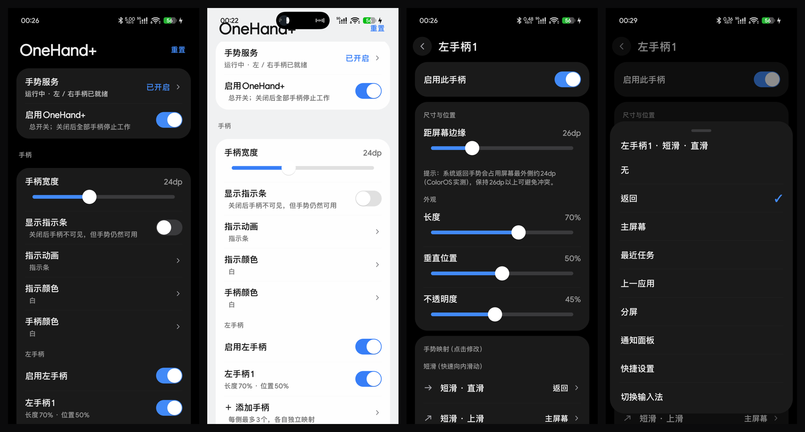

# OneHand+（三星 One Hand Operation+ 复刻）

复刻三星 One Hand Operation+ 核心功能的 Android 手势工具：屏幕左右边缘的透明手柄，向内滑动即可触发用户自定义动作。

## 下载安装

1. 到 [Releases](../../releases) 下载最新 APK（debug 签名，可直接安装）；
2. 安装后打开应用 → 开启无障碍服务「OneHand+ 手势服务」；
3. 屏幕左右边缘出现手柄，向内滑动即可触发动作。手柄位置、边距、手势映射均可在应用内调整。

> 与系统手势导航共存：手柄默认内移 **26dp**，避开系统返回手势热区（ColorOS 实测约 24dp）；可在手柄编辑页调整。

## 功能

- 左/右手柄，每侧最多 3 个，独立长度/位置/不透明度/手势映射；「对齐触钮」可左右同步
- 每手柄 10 个手势槽位：短滑 / 长滑 / 滑动保持（滑入后停住，时长可调）× 直滑 / 斜上 / 斜下 + 长按（原地按住）
- 手势参数：快捷操作（越过阈值立即执行，短/长分别开关）、手势角度（15–60°）、长距离滑动开关与按住持续时间、快速振动、振动强度
- 35 个可用动作：返回、主屏、最近任务、上一应用、分屏\*、通知/快捷面板、切换输入法\*、截图、锁屏、电源菜单、手电筒、
  音量±、音量面板、静音、媒体控制、屏幕超时、旋转、切换导航栏、颜色反转\*、搜索查找、打开应用、语音助手、
  快速工具、快速启动器、任务切换器、虚拟触控板、浮动导航按钮、隐藏手柄…
- 浮窗：快速工具（亮度 + 自定义按钮）、快速启动器、任务切换器、虚拟触控板（光标移动/点击/长按）、浮动导航按钮
- 适配键盘（三模式：手柄移到键盘上方 / 隐藏 / 不处理）、主屏幕时隐藏触钮、指定应用中停用
- 界面：ColorOS 17 真机采样令牌（#000 / #1A1A1A / #428AF7 等）、大标题排版、24dp 分组卡片、自绘 50×30 胶囊开关与 27dp 白钮滑块、勾选式底部弹层
- 动效：入场错峰、按压反馈、浮层弹簧、手柄长滑阈值光晕；窗口声明 preferredRefreshRate（OPPO 实测 144Hz 生效，gfxinfo 中位 10ms）
- 设置备份 / 恢复（JSON）
- 全部本地运行，不申请网络权限

（\* 受系统版本限制，详见 [交付说明](docs/交付说明.md)「已知限制」；真机调研与 50 动作对照见 [真机调研记录](docs/真机调研记录.md)）

## 构建

    ./gradlew assembleDebug
    # 产物：app/build/outputs/apk/debug/app-debug.apk

环境：JDK 17 + Android SDK（compileSdk 35 / minSdk 26），Gradle wrapper 8.11.1 + AGP 8.7.2，纯 Java。

## 文档

- [文档索引](docs/README.md)
- [交付说明](docs/交付说明.md) · [真机调研记录](docs/真机调研记录.md) · [参考项目研究](docs/参考项目研究.md) · [边缘手势冲突研究](docs/边缘手势冲突研究.md) · [v0.5 验证记录](docs/v0.5-验证记录.md) · [UI 概念稿](docs/mockup.html)

## 已知限制

- 分屏 / 切换输入法：Android 12+（尤其 16）系统收紧接口，实测 Android 16 无效（旧版系统可能可用）
- 隐藏导航栏 / 颜色反转：policy_control 等历史机制，新版 Android 可能无效；需 ADB 授权；卸载前先「恢复显示」
- 系统手势导航会抢占最外侧约 24dp 的边缘触摸（ColorOS 实测）：手柄默认内移 26dp 规避（可调）；仍冲突可增大边距或改用三键导航
- Samsung 私有能力（弹出视图 / 最小化弹窗 / AI 多截图 / 录屏工具 / 单手模式 / 游戏助推器 / 模式等）未实现，需系统特权
